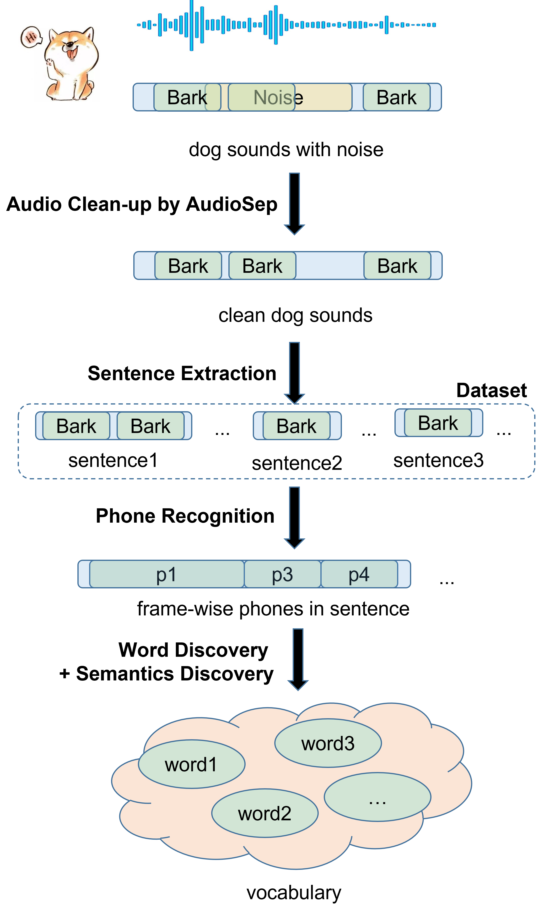
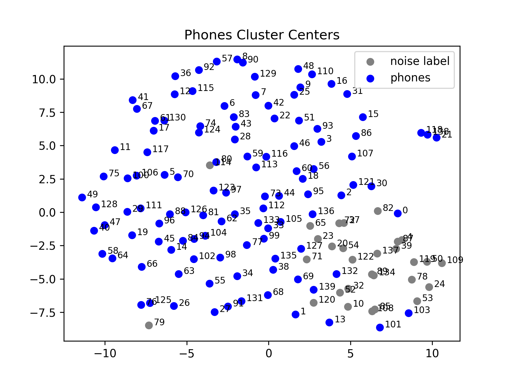

<div align="center">

# 🐶 Phonetic and Lexical Discovery of Canine Vocalization

**Theron S. Wang\* · Xingyuan Li\* · Chunhao Zhang · Mengyue Wu · Kenny Q. Zhu**

University of Texas at Arlington · Shanghai Jiao Tong University
<sub>\* equal contribution</sub>

*Findings of EMNLP 2024*

[](https://aclanthology.org/2024.findings-emnlp.816/)
[](https://huggingface.co/ArlingtonCL2/canine-lexical-models)
[](https://huggingface.co/datasets/ArlingtonCL2/canine-lexical-data)
[](LICENSE)
[](#-quick-start)

</div>

---

## 📖 Overview

<table>
<tr>
<td width="58%" valign="top">

Do dogs have "words"? This repository contains a **fully data-driven pipeline** that finds communication patterns in dog vocalizations without relying on human prior knowledge:

1. 🎧 **Audio clean-up**: AudioSep separates dog sounds from music, speech and noise.
2. ✂️ **Sentence extraction**: a fine-tuned PANNs model cuts dog "sentences" (barks with pauses of at most 0.5 s).
3. 🧩 **Phone recognition**: a self-supervised **Dog-HuBERT** turns every 20 ms frame into one of **140 phones**.
4. 📚 **Word discovery**: an **adaptor grammar** finds recurring phone sequences, which give a vocabulary of candidate "words".
5. 🎬 **Semantics discovery**: a video model recognizes what the dog is doing before and after each word, and the **causal strength** between words and activities tells which words carry meaning.

</td>
<td width="42%" align="center">

</td>
</tr>
</table>

## ✨ Highlights

<div align="center">

| 🎬 YouTube videos | 🗣️ Dog sentences | 🔤 Phones | 📚 Phone coverage by top-200 words | ✅ Words that carry meaning |
|:---:|:---:|:---:|:---:|:---:|
| **6.8k+** | **37,919** (23 h+) | **140** | **91.89%** | **87.1%** |

</div>

- The first **automatic pipeline** that transcribes dog vocalizations into phones and parses them into words with semantics.
- A shallow grammar discovers a vocabulary **without supervision**. It covers 91.89% of the phones in more than 34,000 dog sentences.
- Words such as `116-46-3` are a **reaction** to eating and a **request** for lying down, which looks like "I'm full".

## 🚀 Quick start

```bash
git clone https://github.com/UTA-ACL2/canineLexical.git
cd canineLexical
pip install huggingface_hub
python download.py            # models → ./checkpoints, data → ./data (~820 MB)
```

Transcribe your own dog audio into phones:

```python
import joblib, torch
from fairseq import checkpoint_utils

(model,), cfg, task = checkpoint_utils.load_model_ensemble_and_task(["checkpoints/dog_hubert.pt"])
model.eval()
km = joblib.load("checkpoints/kmeans_layer11_k140.pkl")

wav = torch.zeros(1, 16000)  # your 16 kHz mono dog vocalization
with torch.no_grad():
    feats, _ = model.extract_features(source=wav, padding_mask=None, mask=False, output_layer=11)
phones = km.predict(feats[0].numpy())  # one phone (0-139) per 20 ms frame
```

Reproduce the evaluation:

```bash
cd evaluation
python phone_test/table3.py                                     # Table 3
python phone_durations.py ../data/phones/train.km               # Table 4
python word_statistics.py ../data/words/word_occurrences.csv.gz # Sec. 4.2 word durations, Figure 6
```

## 📦 Models & data

| | Hugging Face | Contents |
|---|---|---|
| 🧠 | [`ArlingtonCL2/canine-lexical-models`](https://huggingface.co/ArlingtonCL2/canine-lexical-models) | Dog-HuBERT (`dog_hubert.pt`) · 140-phone k-means · fine-tuned PANNs dog detector · TSN activity classifier |
| 📊 | [`ArlingtonCL2/canine-lexical-data`](https://huggingface.co/datasets/ArlingtonCL2/canine-lexical-data) | HuBERT manifests · phone transcriptions (`train.km`) · adaptor-grammar inputs and parses · every word occurrence · activity labels |

> [!NOTE]
> Audio and video are not redistributed. Sentence file names identify the source YouTube or AudioSet video.

## 🗂️ Repository structure

```
canineLexical/
├── 1_audio_cleanup/            # §2.1  AudioSep with the text query "Dog"
├── 2_sentence_extraction/      # §2.2  PANNs
│   ├── first_cut/              #       find regions with dog sounds
│   ├── second_cut/             #       fine-tune PANNs, cut sentences (pauses ≤ 0.5 s)
│   └── remove_noise/           #       drop sentences dominated by non-dog tags
├── 3_dataset/                  # §2.3  fairseq manifests, sentence → video mapping
├── 4_phone_recognition/        # §3.1  k-means sweep, checkpoint trimming
├── 5_word_discovery/           # §3.2  adaptor grammar (PyAdaGram) + data preparation
├── 6_semantics/                # §3.3  TSN activity recognition, causal strength
├── evaluation/                 # §4    Tables 3-4, word statistics
├── results/                    # discovered vocabulary with counts
├── assets/                     # figures used in this README
└── download.py
```

The scripts are the ones used for the paper. Many contain absolute paths from our servers, both in their defaults and in the example commands in their docstrings. Change these to your own paths before running.

## 🔬 Pipeline

### 1️⃣ Audio clean-up and 2️⃣ sentence extraction

<details>
<summary><b>AudioSep → PANNs first cut → fine-tuned PANNs second cut → noise filter</b></summary>

- **AudioSep.** Clone [AudioSep](https://github.com/Audio-AGI/AudioSep), download `audiosep_base_4M_steps.ckpt`, and copy `1_audio_cleanup/*.py` into `AudioSep/work/`:
  ```bash
  python work/separate.py --input_path first_cut.jsonlines --output_root out/separation \
         --log_root log --checkpoint_path checkpoint/audiosep_base_4M_steps.ckpt --device 0
  ```
- **PANNs.** Each folder in `2_sentence_extraction/` is a `work/` folder that goes inside a clone of [audioset_tagging_cnn](https://github.com/qiuqiangkong/audioset_tagging_cnn). `second_cut/train.py` also needs `pip install git+https://github.com/fgnt/sed_scores_eval.git`. The steps run in this order:
  1. `first_cut.py`: pretrained Cnn14_DecisionLevelMax, Dog class, threshold 0.05, ±1 s.
  2. AudioSep on the first-cut regions.
  3. `train.py`: fine-tune PANNs on 1,483 hand-labelled clips. Then `second_cut.py` (threshold 0.28) merges detections less than 0.5 s apart into sentences.
  4. `remove_noise.py --topk 10 --threshold -0.7`: drops sentences whose Dog score is below 0.1 or whose non-dog tags score close to or above Dog.

  The exact commands are in the docstring at the top of each script.

</details>

### 3️⃣ Phone recognition: Dog-HuBERT

<table>
<tr>
<td width="55%" valign="top">

We pretrain **Dog-HuBERT** on all dog sentences with the [fairseq HuBERT recipe](https://github.com/facebookresearch/fairseq/tree/main/examples/hubert):

| | Stage 1 | Stage 2 |
|---|:---:|:---:|
| Clusters | 100 | 150 |
| Steps | 80k | 60k |
| Learning rate | 1e-4 | 1e-4 |

The **140 phones** are a K-means over layer-11 features of the stage-2 model. 29 of the clusters are noise labels, listed in `evaluation/phone_durations.py`.

</td>
<td width="45%" align="center">

<br><sub>t-SNE of the 140 phones (grey: noise labels)</sub>
</td>
</tr>
</table>

<details>
<summary><b>Commands</b></summary>

`3_dataset/get_tsv.py` builds the manifests (34,056 training + 3,863 validation sentences). With fairseq's `simple_kmeans` scripts:

```bash
python dump_hubert_feature.py <tsv_dir> train checkpoint_145_60000.pt 11 1 0 <feat_dir>
python learn_kmeans.py <feat_dir> train 1 60k_11th_km140.pkl 140 --percent 1.0
python dump_km_label.py <feat_dir> train 60k_11th_km140.pkl 1 0 <label_dir>   # -> train.km
```

- `train.km` has one line per sentence and one cluster ID per 20 ms frame.
- `4_phone_recognition/find_cluster.py` sweeps K and records inertia, silhouette and Calinski–Harabasz scores.
- The released `dog_hubert.pt` is `checkpoint_145_60000.pt` with the optimizer state removed by `trim_checkpoint.py`; its features are identical.

</details>

### 4️⃣ Word discovery: adaptor grammar

```
Sentence → Word+        Word → Phone+        Phone → p,  p ∈ {0, …, 139}      (Word is adapted)
```

<details>
<summary><b>Data preparation → PyAdaGram training → word extraction</b></summary>

`5_word_discovery/PyAdaGram/` is Ke Zhai's [PyAdaGram](https://github.com/kzhai/PyAdaGram) (hybrid variational-MCMC inference, Zhai et al. 2014). Its original README is kept as `README_PyAdaGram.md`.

1. **Prepare the data** with `data_process.py`:
   - `read_transcription(train.km, mode='normal')` merges repeated frame labels into phones.
   - `retain_limit_length_sentence(..., limit_length=100)` keeps sentences of at most 100 phones (31,294 sentences) and writes `train.dat`, `train_audio.dat` and `train_ori.dat`. Copy `train.dat` to `truth.dat`.
2. **Grammar**: `data/grammar.unigram`.
3. **Train** for one pass over the data:
   ```bash
   cd 5_word_discovery/PyAdaGram
   python -m launch_train --input_directory=../short-dog --output_directory=../ \
          --grammar_file=../short-dog/grammar.unigram --number_of_documents=31294 \
          --batch_size=128 --training_iterations=244 --tau=512 --kappa=0.8 \
          --number_of_processes=32
   ```
4. **Extract words.** `word_validation.py::generate_words_clips_adagram` aligns the parses back to the audio. The resulting vocabulary is `results/vocabulary_word_counts.json` (7,326 words).

`plot_chart.py` draws the parse example in Figure 5.

</details>

### 5️⃣ Semantics discovery: causal strength

<details>
<summary><b>TSN activity recognition → Algorithm 1 → causal strength</b></summary>

- **Activity recognition.** A TSN-R50 ([mmaction2](https://github.com/open-mmlab/mmaction2), config `6_semantics/tsn/configs/tsn_shiba_0525.py`) was fine-tuned on 2,534 labelled clips. `activity.py`:
  - splits each video into stable shots with `TransnetV2.py`,
  - labels 2-second clips from 5 s before to 5 s after each sentence, and
  - merges consecutive clips that have the same label.
- **Causal strength.** `statistics.py::statistic()` combines the word occurrences with the activity labels:
  - `analysis2()` is Algorithm 1 (thresholds 0.5 and 0.3). It puts each activity *before*, *during* or *after* each word.
  - `generate_p()` counts activity–word co-occurrences. Activities *before* a word give the **reaction** CS; activities *after* it give the **request** CS.
  - `get_top100()` keeps the top 200 words after removing words that are at least half noise.
  - `show_top100()` plots each word's activity profile (Figures 7–8).

</details>

## 📊 Results

| Result | Script | Output |
|---|---|---|
| **Table 3**: phone listening test, 140 same-phone + 150 different-phone pairs | `evaluation/phone_test/table3.py` | Tester 1: 58.28 / 62.86 / 54.00 · Tester 2: 60.00 / 66.43 / 54.00 · Agreement: 71.38 / 75.00 / 68.00 |
| **Table 4**: phone durations (mean / median / std) | `evaluation/phone_durations.py` | Dog 60.5 / 40 / 65.5 ms · Noise 37.3 / 20 / 35.3 ms · All 52.5 / 40 / 58.0 ms |
| **§4.2**: word durations, top 100 / 200 | `evaluation/word_statistics.py` | Mean 0.064 s / 0.072 s |

Tables 1 and 5–7, Figures 3, 4 and 7–8, and the 87.1% human judgement were produced with the code above. Their intermediate files and plotting scripts are not part of this release.

## 🔗 Related work

- 🏆 **Toward Automatic Discovery of a Canine Phonetic Alphabet** (ACL 2025, Outstanding Paper): six breeds, 152 h of vocalizations, and minimal-pair refinement into a canine phonetic alphabet. Code: [TheronWang/canine-word](https://github.com/TheronWang/canine-word)

## 📝 Citation

If you find this work useful, please cite:

```bibtex
@inproceedings{wang-etal-2024-phonetic,
    title = "Phonetic and Lexical Discovery of Canine Vocalization",
    author = "Wang, Theron S.  and Li, Xingyuan  and Zhang, Chunhao  and Wu, Mengyue  and Zhu, Kenny Q.",
    booktitle = "Findings of the Association for Computational Linguistics: EMNLP 2024",
    month = nov,
    year = "2024",
    address = "Miami, Florida, USA",
    publisher = "Association for Computational Linguistics",
    url = "https://aclanthology.org/2024.findings-emnlp.816",
    doi = "10.18653/v1/2024.findings-emnlp.816",
    pages = "13972--13983",
}
```

## 🙏 Acknowledgements

Kenny Q. Zhu is partially supported by NSF Award No. 2349713. This repository includes [PyAdaGram](https://github.com/kzhai/PyAdaGram) by Ke Zhai and builds on [AudioSep](https://github.com/Audio-AGI/AudioSep), [PANNs](https://github.com/qiuqiangkong/audioset_tagging_cnn), [fairseq HuBERT](https://github.com/facebookresearch/fairseq/tree/main/examples/hubert), [mmaction2](https://github.com/open-mmlab/mmaction2) and [TransNetV2](https://github.com/soCzech/TransNetV2).

## 📄 License

[MIT](LICENSE)
